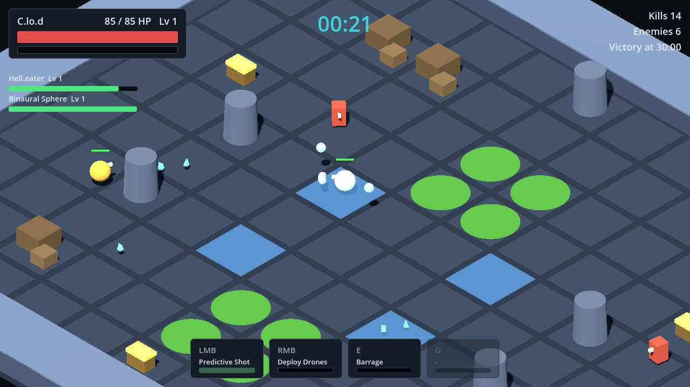

# SINGULARITY: Global Operations (foundation prototype)

A private, locally playable Godot 4 prototype: a 3D orthographic-isometric roguelite where emergent machine
intelligences fight for planetary authority. This folder is Unit A of the GDD: a complete, playable foundation with
placeholder geometry, built to be reviewed, tuned and partly rewritten.



More: [tactical overview](docs/screenshots/tactical_overview.png), [level-up](docs/screenshots/level_up.png), [character select](docs/screenshots/character_select.png). Screenshots were rendered with software OpenGL; they are for layout review only.

## Requirements and running

- Godot **4.3** or newer (4.x GDScript, Compatibility renderer). No other dependencies, no addons.
- Open this folder (`singularity/`, the one containing `project.godot`) in the Godot editor and press **F5**, or run
  `godot --path singularity` from the repository root.
- First launch in the editor imports the project once. Settings, profile and telemetry are written to Godot's
  `user://` folder (never to the project).

## Controls (all rebindable in Settings > Input)

| Action | Default |
|---|---|
| Move | WASD or arrow keys |
| Aim | Mouse (projected onto the ground plane) |
| Primary attack | Left mouse button or J (hold to repeat) |
| Ability 1 / Ability 2 | Right mouse button or Space / E |
| Use equipment item | G |
| Open nearby chest | F |
| Tactical overview | T (then 1 Follow, 2 Hold, 3 Aggressive for AI allies) |
| Rotate camera 45 degrees / zoom | Q and R / mouse wheel |
| Inventory | Tab or I |
| Pause | Esc or P (also pauses when the window loses focus) |
| Level-up choice | 1, 2, 3 or arrow keys + Enter |

Menus are fully keyboard-navigable (arrows/Tab to move focus, Enter to activate, Esc to go back). The accessibility tab has
an auto-attack option, high-contrast UI, UI scale, reduced motion, a screen-shake slider, damage-number toggle and
colour-blind-safe team palettes.

Debug builds (editor runs) also have: **F1** debug overlay, **F2** +50 XP, **F3** spawn a chest, **F4** skip 60 s,
**F5** god mode.

## What is in the build

- Main menu, character select (12 singularities, up to 2 AI allies), settings, pause, inventory, level-up and run-end screens.
- LAB-00: The Containment Breach. A 14 x 12 cell arena built from modular primitives, with a baked navigation mesh,
  walls, pillars, crates, coolant pools (damage + slow), cycling arc panels (telegraphed damage) and item chests.
- Real-time combat: projectiles, melee arcs, dashes, pulses, drones, vortexes, guard. Enemies chase via navigation, one type
  shoots from range, an elite warden spawns periodically and drops a chest.
- Progression: physical XP gems with magnet pickup, XP curve from a Resource, queued level-ups, three weighted choices,
  prerequisites, exclusions, stacking limits and diminishing returns. Items (from chests) are a separate system with
  rarities, passive stats, proc effects and one active equipment slot.
- Four fully-kitted singularities (mindShape, Hell.eater, C.lo.d, Binaural Sphere) and eight data-defined ones that run on a
  clearly labelled placeholder kit.
- An authoritative command gateway shared by the human, conventional AI and a stub for future external agents.
- Telemetry (JSON per run), central balance config, and headless check suites.

## Architecture in one page

```
project.godot            autoloads: Events, Balance, Catalog, Settings, Profile, Telemetry, GameState
scenes/main.tscn         the only scene the game runs; scenes/modules/*.tscn are placeholder map pieces
data/                    all game data as Godot Resources (.tres): balance, characters, upgrades, items, enemies,
                         agent profiles, map layout, module library
scripts/autoload/        global services (signal bus, state machine, settings, catalog, telemetry, profile)
scripts/resources/       Resource class definitions (the schema of the data files)
scripts/core/            simulation: RunSession, Combatant, actors, abilities, projectiles, XP, items, director, camera
scripts/agent/           ActionCommand, ActionResult, CommandValidator, ObservationBuilder (the agent boundary)
scripts/maps/            MapBuilder (layout + module library -> scene + navigation)
scripts/ui/              theme, reusable components, screens, HUD
tools/                   data generator, economy projection, observation dump
tests/                   headless check suites
docs/                    module spec and screenshots
```

Key ideas:

- **RunSession is the authoritative simulation.** Everything that wants to act calls `RunSession.submit_command()`.
  `CommandValidator` checks actor existence, liveness, ownership, capability profile, rate limit, parameters, cooldowns and
  range before anything changes. Humans (`HumanController`), AI allies (`ConventionalAIController`) and enemies all use it.
- **Controllers only see observations.** `ObservationBuilder` produces a JSON-safe dictionary limited by an
  `AgentCapabilityProfile` (radius, entity cap, decision rate, allowed commands). See `AGENT_INTERFACE.md`.
- **Mechanical power and agent intelligence are separate data.** Characters live in `data/characters`; what a controller may
  see and do lives in `data/agent_profiles`.
- **Data over code.** Stats, abilities, upgrades, items, enemies, XP curve, spawn schedule and rarity weights are Resources.
  `BALANCING.md` explains how to tune them.
- **Signals for decoupling.** Gameplay emits on `Events`; UI, telemetry and effects listen.
- **Maps are layouts plus a module library.** `data/maps/lab_00.tres` is an ASCII grid; `data/modules/lab_modules.tres` maps
  module ids to scenes. Swap scene paths to move to Blender assets (see `docs/MODULE_SPEC.md`).

## Verifying the build (headless, no display needed)

```
# 1. Rules, simulation and lifecycle checks (~200 checks, about 1 minute)
godot --headless --path singularity --fixed-fps 60 res://tests/run_checks.tscn
# 2. End-to-end flow through the real Main scene: menus, pause, level-up, restart, defeat (~30 checks)
godot --headless --path singularity --fixed-fps 60 res://tests/run_ui_flow.tscn
# 3. XP economy projection against the level targets
godot --headless --path singularity res://tools/economy_sim.tscn
```

Both suites exit non-zero on failure. Headless Godot prints many `Parameter "m" is null` lines from its dummy renderer when
meshes are freed; they are harmless and do not occur in a normal windowed run.

Regenerate the `.tres` data and placeholder module scenes after editing `tools/generate_data.gd` (this overwrites hand edits):

```
godot --headless --path singularity res://tools/generate_data.tscn
```

If you add a new `class_name` script, run `godot --headless --path singularity --import` once so the class cache updates.

## Documents

- `DEVELOPMENT_NOTES.md`: assumptions, decisions, deviations from the GDD, known limitations, what was and was not verified.
- `BALANCING.md`: formulas, initial values, tuning workflow.
- `AGENT_INTERFACE.md`: the contract for future external (LLM) agents, LAN and MCP.
- `docs/MODULE_SPEC.md`: how to build map modules in Blender.
